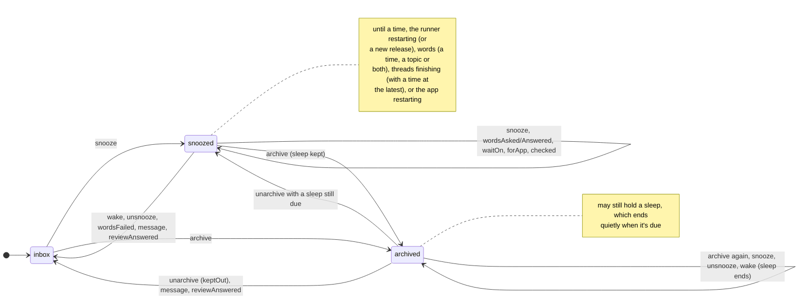

# The backend's lifecycles

Written 17 Nov 2026 (thread f2beccf5) for moving the backend's lifecycles onto
explicit state machines, one at a time. A lifecycle here is a row (or a group
of fields on one) that moves through stages over time: a status, a lease, a
`usedAt` or `revokedAt` that works as a flag. Everything below was found by
reading the code, unless it says it was tested.

## Done

| Lifecycle | States | What was wrong | Fixed in |
|---|---|---|---|
| `commands.state` (`convex/sync.ts`, "A command's lifecycle") | pending, taken, done, failed (plus `lapsedAt` on a failed one) | A take whose answer was lost made the runner's retry get `false`, so the command was dropped and stayed taken for 14 days. A finish overwrote however a command had ended. A runner that stopped mid-apply left the phone on "Sending…" for two weeks. | API 85: `takeCommand`'s `attempt`, a finish only from taken (or lapsed), a 3-hour lease (`lapseCommands`) that fails it without handing it out again |
| `threadMoves.state` (`convex/moves.ts`) | asking, ready, packing, unpacking, claimed (and handedOver, shown as claimed), done, failed, cancelled | A move left `ready` (its source runner gone) was never ended, so the thread could never move again. A `moveDone` that didn't go through (a network blip) was never sent again, so the move stayed claimed and the thread couldn't move again until T restarted. | `expireMoves` fails a ready move once its source has been gone 10 minutes, or after 12 hours. The runner tries T's adopt and done again (runner/src/moves.ts `retry`), and any step the backend refuses while it's being updated |
| `runnerRequests.state` (`convex/relay.ts`) | pending, claimed, allowed, denied, closed | A claim that went through but whose answer was lost left the request "being started" with nothing started. | API 85: `decideRequest`'s `claim`, one answer per request at a time. Still open: a lost claim followed by a runner restart stays claimed until the asking card expires (an hour); handing it back on a timer could start the thread twice, as a claimed request may already be starting elsewhere |
| `threads.pushHeldAt` / `pushedAt` with `runners.atMac` (`devices.ts` holdPush, `sync.ts` setPresence, sendHeldPushes, sendStaleHeldPushes) | none, held, sent or dropped | **Race:** `push.notify` read Mike at the Mac, he left and the drain ran with nothing held, then `holdPush` held the push anyway, and the stale-push cron only looked at runners still at the Mac: a missed "needs you" until he next sat down and left again. | Daybreak 148, 17 Nov 2026 (6ac6f8554 and the two before it): `holdPush` asks again in the same transaction and sends it to the away phones if he's gone (once; a second bounce is held), and the cron sends anything held for a runner that's away. `runner/test/unit/push-hold.test.ts` plays each order. Not a machine: it lives on the runner-mirrored `threads` row. One edge left as designed: the main Mac taking a thread over from another runner starts it clean, held push included |
| `schedules.claim` (`{ holder, until }`, 2-minute lease) with `nextRunAt`, `lastRun` (`sync.ts` claimSchedule, scheduleRan; `runner/src/schedules.ts`) | due, claimed, ran or released | **Double run:** the claim was never renewed. A check can run 5 minutes, and a run whose record didn't get through kept the row due, so in a restart's handover the other runner process took the lapsed claim and sent the run again (tested). | 18 Nov 2026: the runner holds the claim (`hold`), taking it again every 45 seconds while it checks, sends and records the run, confirms it just before the send, and keeps it until `scheduleRan` lands. Runner-only: the backend already let the same holder take its claim again. Not a machine: schedules are the runners' own rows (`adoptSchedules`) |
| `threadClears` (`sync.ts` clearThread, dropThreadRows) | clearing, awaitingOwner (a takeover's rows gone), cleared | **Stuck id:** a thread's old rows go in scheduled runs while the id is closed to every write. A run that threw was never started again, so the id stayed closed for good and every write under it was skipped. | 18 Nov 2026: a state machine (`convex/clearMachine.ts`) whose `clearing` state starts the runs again after 10 minutes with none moving it on (`STALLED`, an `at` timer each run moves); rows from before it get their timer from a cron (`armClears`) |
| `relayInstall` (`push.ts`, `devices.ts`), now `relayRegistrations.installState` | registering, registered, unregistered | **Race:** two sends registered at once; each registration rotates the relay's key, so the key saved last could be the dead one. A 401 then failed that push, sent the send's other phones with the same dead key, and cleared whatever key was saved, even a newer one. | 20 Nov 2026: a state machine (`convex/relayInstallMachine.ts`) on a new table, so no stepping stone (an install saved before it is taken over by its first send, `ADOPT`). One send registers at a time and the rest wait for its key (`LAPSED`, an `at` timer, if it never answers in 40 seconds); a refusal clears only the key it was made with (`attempt`); the send registers again and sends that push once more, once per send. A registration that got no answer keeps the install until its time is up, and `/relay/verify` says yes only while the registering send is still waiting for the answer and holds the install with 8 seconds to spare, so one given up on can't replace the next one's key at the relay (unless the relay itself stalls past that between its check and its write). A registration the relay turns down holds sends off for a minute, and a key refused within two minutes of being given (by any send) for five, so a relay refusing new keys can't use up its 20 a day. `runner/test/unit/relay-install.test.ts`. The relay needed no change |

Commands, moves, runner requests and thread clears are now state machines (below).
A virtual runner's box (`boxes.boxState`, docs/virtual-runners.md) was
born one on 18 Nov 2026 (`convex/boxMachine.ts`): a new table, so nothing
to backfill and no stepping stone. From 20 Nov 2026 an `expired` box is purged
(`PURGE`, to `purged`, deleted in the same step) once its virtual runner's
`deleteAfterDays` have passed again and the provider has no box of it, with
its thread's and runner's rows (`boxService.ts purgeExpiredBoxes`, a cron that hands each box to `purgeBox` and `forgetBox`, in runs of its own):
before, every virtual-runner thread left its `runners` row for good. A login's cloud token for boxes
(`cloudTokens.tokenState`: valid, dead once a box's turn on it is refused)
became one on 19 Nov 2026 (`convex/cloudTokenMachine.ts`), with a
`tokenState` backfill (rows set before it are valid), and boxes gained
`needsToken`, waiting for one.

## Still to do, most worth it first

| # | Lifecycle | Stages | What's wrong (by reading) | Size |
|---|---|---|---|---|
| 2 | `uploadTickets`, `phoneUploads`, `relayUploads` (`usedAt`, `claim`) | issued, claimed, finished or refused | Sound. Three copies of the same claim and finish could share one machine. | S |
| 3 | `storageOwners.attachedAt` | unattached, attached, deleted | None found. | S |
| 4 | `tokens.revokedAt` / `expiresAt`, `pairingCodes.usedAt` | issued, used or expired; live, revoked or expired | None found. | S |
| 5 | `runnerKeys.revokedAt` | live, revoked | None. | S |
| 6 | relay `installs` (`relay/convex/relay.ts`) | registered, active, expired, registered again | None left: the rotation race is handled on the backend's side (`relayInstallMachine.ts`, above). | S |

Simple expiry, not worth a machine: `messages.pagedAt`, `heldPictures.at`,
`eventBodies.at`, and the `threadTombstones`, `threadGone` and `scheduleGone`
markers.

Deliberately left out: the runner-owned copies of threads (`threads`,
`threadIndex`: `status`, `archivedAt`, `starredAt`, `view`). The runner is
their source of truth; the backend only mirrors them.

## On the runner

The runner's own lifecycles are plain types, no library: a discriminated
union with a `kind` and one function that makes every move, like
`runner/src/moves.ts` and `runner/src/update.ts`.

**Where a thread is parked** (`runner/src/place.ts`, 20 Nov 2026): in the
inbox, snoozed (hibernating) or archived. The record keeps its fourteen
fields as they were (`snoozedUntil`, `snoozedUntilRestart`, `untilRelease`,
`wakeWhen`, `waitingOn`, `hibernatedForApp`, `snoozedAt`, `woke`,
`wakeChecked`, `archivedAt`, `archivedBy`, `archiveVerdict`,
`unarchivedBySchedule`, `keptOut`), as the apps, Convex, forks and older
runners read them by name; `placeOf` reads them as a `Place`, and every write
is an event through `parkRecord` (`Runner.park`), which `place.test.ts`
holds the rest of `runner/src` to. A sleep goes on inside the archive.

**A turn's reply phase** (`runner/src/reply-phase.ts`, 20 Nov 2026): what
happens around `end_turn`, seventeen fields on a Turn (in memory only) read as
working, ended, replying, reopened or open, written only by `replyTurn`
(`Runner.reply`). Drawn in docs/protocol/needs-you.md, "The reply phase".

**A thread's CLI** (`runner/src/cli-session.ts`, 21 Nov 2026): none, a spare
warm start began for it, starting, live or closing, eleven Runtime fields (in
memory only: `session`, `spare`, `generation`, `closing`, `releasedGen`,
`resumed`, `retriedFresh`, `started`, `releaseWhenIdle`, `versionMove`,
`tasks`) written only by `cliRuntime` (`Runner.cli`). Events from a CLI or a
step that waited on one carry its generation, and an older one's are dropped
there (which fixed a refused setting restarting the CLI after it). Drawn in docs/protocol/updates.md, "A thread's CLI".

Next on the runner, most worth it first: sync's command intake and the
worktree slot.

## Moving them onto @convex-dev/state-machines

Mike's apps put lifecycles on his state machines library, vendored in
`vendor/` (he OK'd publishing it in this public repo on 17 Nov 2026). The
machines are drawn in [machines.md](machines.md) and on the website's
Machines page (`/machines`). So far: **commands** (`convex/commandMachine.ts`),
**moves** (`convex/moveMachine.ts`), **runner requests**
(`convex/requestMachine.ts`, no timers: a request's card expires on the
asking runner, which closes it), **thread clears**
(`convex/clearMachine.ts`) and **boxes** (`convex/boxMachine.ts`, a thread's
box on a virtual runner, with a boot timeout and a heartbeat lease) and **cloud
tokens** (`convex/cloudTokenMachine.ts`, no timers) and the **push relay
install** (`convex/relayInstallMachine.ts`, a new table like boxes). Next,
one at a time, the table above.

Moves keep each deadline as a time in the state's data (`askBy`,
`giveUpAt`), not a delay from entering it: the backfill brings a move over
with the deadline it already had, and once the machine is live the sweep
(`expireMoves`) arms the timers of any move that has none. Unpacking keeps
the 30 minutes from when the thread was frozen, as before.

Two things are particular to Threadbear, and each machine follows them:

- **Clients read the state strings.** The App Store iPhone app, the website
  and older runners read `state` as plain strings (`phone:command`,
  `phone:waiting`, `relay:commandState`, `moves:moves`). A machine's state is
  a `{ kind, ... }` union, so it goes on a field of its own (`commandState`,
  `moveState`, `requestState`), and the machine's effects write the old
  string from it on every move, so functions keep answering with the strings
  and the old indexes keep working.
- **Every deployment upgrades itself, from whatever it last ran.** Each
  main Mac's runner deploys `convex/` from the commit it updates to
  (`runner/scripts/deploy-backend.mjs`), and other people's copies bring in
  Mike's releases days apart, skipping commits. A machine needs its field
  required, and Convex refuses to deploy a schema that rows already stored
  don't match, and forks carry schema changes of their own. So the switch
  (the field `requiredUnlessStepping`, the machine on it, a backfill in
  `convex/migrations.ts` and its name in `convex/migrations.json`) is
  deployed in two steps by the deploy script: once with
  `convex/stepping.ts` naming the backfill (the field optional, the machine
  off and its functions saying "try again in a minute"), then, after
  `migrations:run` has said done, as it is
  (`runner/scripts/backend-stones.mjs`). It only ever deploys the tree it's
  updating to: an earlier design that deployed the widen commit first broke
  on merges and on forks' own schema changes (Codex's review). Ville's and
  Keith's servers go through it with nothing to do by hand.

The functions still use Convex's own builders and send the machine's role
events from them, after checking the caller's key or token themselves (the
roles' checks pass: auth here is in args, not `ctx.auth`). Crons that send
`server` events or purge rows use the catalog's `internalMutation`.
